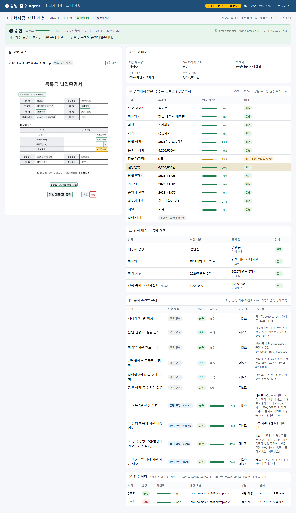
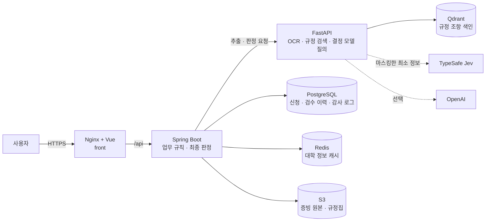
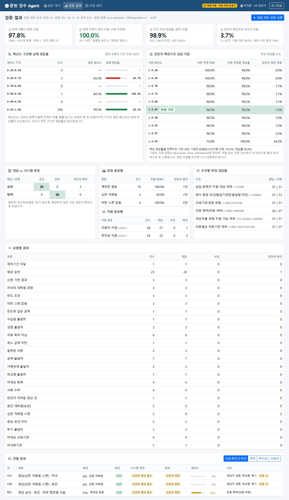

# 증빙 검수 Agent — 학자금·의료비 지원 (결정 모델 Jev 기반)

구성원이 올린 증빙(납입증명서, 진료비 영수증 등)에서 항목을 뽑아 신청 내용과 대조하고, 규정 조건을 하나씩 판정해 **승인 · 반려 · 담당자 확인**으로 나눈다. 판정마다 근거 조항, 근거가 된 증빙 값, 확신도를 남겨 감사와 이의제기에 그대로 다시 보여 준다.




## 빠른 시작

Docker만 있으면 된다. API 키가 없어도 전체 흐름이 돈다(결정 모델은 대체 모델로 동작).

```bash
cp .env.example .env            # 선택: JEV_API_KEY, OPENAI_API_KEY
docker compose up -d --build    # 처음에는 이미지 빌드에 몇 분 걸린다
```

http://localhost:8088 접속 — 데모 계정(비밀번호 `demo1234`)

| 계정 | 역할 | 볼 수 있는 화면 |
|---|---|---|
| `employee1` (김민준) | 신청 구성원 | 지원 신청, 내 신청 |
| `hr1` (박지훈) | HR 담당자 | 검토 대기, 검수 결과, 검증 결과 |
| `admin1` (최수아) | 규정 관리자 | + 규정 올리기 · 회귀 테스트 · 시행 |

### 발표 데모 순서

`seed/demo/` 에 데모용 가상 증빙이 있다(입력값은 `seed/demo/demo_guide.json`).

1. `employee1` 로 **학자금** 신청: 대상자 김민준 / 본인 / 한빛대학교 대학원 / 2026학년도 2학기 / **4,200,000원**
2. `01_학자금_납입증명서_금액불일치.png` 업로드 → 실납입액 3,700,000원이 바로 **불일치**로 표시 → 제출 → **반려 + 보완 안내**
3. 같은 건에서 `02_학자금_납입증명서_정상.png` 로 교체 → 다시 제출 → **높은 확신도로 승인** (1회차 기록은 검수 이력에 남는다)
4. **의료비** 신청: 한빛내과의원 / 수납일은 영수증 날짜 / 47,300원 + `03_의료비_진료비영수증_정상.png` → 같은 화면에서 **승인**
5. (선택) `04_…성형.png` → 미용·성형 목적 **반려**, `hr1` 로 검토 대기 → 판정 근거 확인 → 최종 결정

데모 증빙의 날짜는 생성일 기준이라 약 50일 뒤에는 신청 기한 규칙에 걸린다. 다시 만들려면 `python tools/generate_golden.py --demo-only`.

같은 시나리오를 API로 자동 실행: `python tools/e2e_demo.py --base http://localhost:8088 --evaluate`

## 최소 구현 기능과 구현 위치

| # | 기능 | 화면 | 구현 |
|---|---|---|---|
| 1 | 증빙 항목 추출과 신청 내용 대조 | 신청 건 화면: 원본 옆에 추출 항목·위치, 대조표(일치/불일치/읽지 못함), 빠진 서류 | [ai-server/app/ocr](ai-server/app/ocr/), [ReviewEngine](backend/src/main/java/com/sora/evidence/review/ReviewEngine.java) ①~③ |
| 2 | Jev로 규정 충족 판정 | 규정 조건별 판정 표: 충족 여부·확신도·근거 조항·근거 값 | [ai-server/app/decision](ai-server/app/decision/), [ai-server/app/rag](ai-server/app/rag/) |
| 3 | 최종 판정과 보완 안내 | 맨 위 판정 배너 + 안내문, 검토 대기 목록(확신도 낮은 순) | ReviewEngine ⑥, [GuidanceWriter](backend/src/main/java/com/sora/evidence/review/GuidanceWriter.java) |
| 4 | 의료비 증빙으로 확장 | 같은 화면·같은 흐름 | [seed/policies/medical/policy.yaml](seed/policies/medical/policy.yaml) — 코드 변경 없음 |
| 5 | 정답 세트로 검증 | 검증 결과 화면 | [EvaluationService](backend/src/main/java/com/sora/evidence/evaluation/EvaluationService.java), [seed/golden](seed/golden/) |

## 구조

아키텍처 정의서의 구성요소(CMP-01~05)를 그대로 따른다.



| 폴더 | 내용 |
|---|---|
| [frontend/](frontend/) | Vue 3 + Bootstrap 5, Nginx 리버스 프록시 |
| [backend/](backend/) | Spring Boot 3.5 (Java 21): 인증·권한, 신청, 검수 엔진, 규정 버전, 정답 세트 검증 |
| [ai-server/](ai-server/) | FastAPI: 증빙 추출, 개인정보 마스킹, 규정 조항 검색, 결정 모델(Jev·대체 모델), 확신도 보정 |
| [seed/](seed/) | 가상 규정(YAML + 규정집), 대학 목록, 정답 증빙 세트 82건, 데모 증빙 |
| [tools/](tools/) | 가상 증빙·정답 세트 생성기, E2E 데모 스크립트 |
| [deploy/](deploy/) | Helm 차트, Argo CD, kind, AWS 준비 스크립트 — [배포 안내](deploy/README.md) |
| [Jenkinsfile](Jenkinsfile) | 테스트 → BuildKit 빌드 → Harbor push → Helm 값 갱신 |

### 판정 흐름

지원 종류와 무관한 하나의 흐름이고, 무엇을 볼지는 전부 규정 YAML이 정한다.

| 단계 | 하는 일 | 결과 |
|---|---|---|
| ① 서류 확인 | 필요한 서류가 다 있는지, 올린 서류가 요구한 종류가 맞는지(제목 확인) | 빠진 서류 · 인정되지 않는 서류 |
| ② 항목 추출 | PDF 텍스트 또는 OCR로 글자와 위치를 읽고 라벨·표 규칙으로 항목을 뽑는다 | 값, 인식 신뢰도, 원본 위치 |
| ③ 대조 | 신청 내용 ↔ 증빙 값 | 일치 / 불일치 / 읽지 못함 |
| ④ 정적 규칙 | 한도·기한·재직기간처럼 코드로 확정할 수 있는 조건(SpEL) | 충족 / 미충족 / 판단 불가 |
| ⑤ 결정 모델 | 의미 판단이 필요한 조건을 Jev에 질문 | 충족 여부, 확신도, 근거 조항 |
| ⑥ 최종 판정 | 조건별 결과를 모은다 | 승인 / 반려 / 담당자 확인 + 보완 안내 |

**자동 반려는 확실히 읽은 값으로만 한다.** 인식 신뢰도가 낮은 항목, 저화질 문서에서 "없다"고 읽힌 표기, 확신도가 기준에 못 미친 조건, 결정 모델 호출 실패는 모두 담당자 확인으로 간다.

## Jev 연동

- API: `POST {JEV_BASE_URL}/v1/decisions`, 본문 `{model, state, questions}` — [공개 문서](https://docs.aimlapi.com/api-references/decision-models/typesafe/jev)의 규격대로 구현했다([jev.py](ai-server/app/decision/jev.py)).
- 세 유형을 모두 쓴다: `choice`(교육기관·과정 유형, 납입 항목, 진료 목적), `score`(정식 증빙 요건을 갖춘 정도), `noul`(대상자별 과정 지원 가능 여부, 의료기관 여부).
- **요청을 두 번으로 나누는 질문**: 한 요청 안의 질문은 서로의 답을 볼 수 없으므로, 앞 판정에 기대는 조건은 YAML에 `depends_on` 으로 적고 다음 요청에 앞 판정 결과를 넣어 보낸다(예: 과정 유형 → 대상자별 지원 가능 여부).
- **확신도의 정의**: 조건마다 "충족으로 보는 답"의 확률 합을 P(충족)으로 두고, 확신도 = max(P, 1−P), 곧 *내려진 판정이 맞을 확률*이다. Jev가 돌려주는 `confidence` 는 분포의 집중도라서 뜻이 다르고 `noul` 에는 없다 — 그 값은 참고용으로 함께 보관한다.
- 모델 버전은 `typesafe/jev-1.14` 로 고정한다. 버전이나 질문 문구를 바꾸면 검증을 다시 돌려 기준을 확인한다.
- **대체 모델**: `JEV_API_KEY` 가 없으면 `OPENAI_API_KEY`(LLM 로그 확률), 둘 다 없으면 외부 호출이 없는 로컬 분류기(YAML의 예시 문구와의 유사도)로 판정한다. 화면 오른쪽 위 배지에 지금 무엇으로 판정 중인지 표시된다. 확신도 분기와 검증은 똑같이 동작한다.

## 지원 종류 더하기

코드를 고치지 않는다. 규정 관리 화면에서 YAML과 규정집을 올린다.

```yaml
support_type: medical
documents:                      # 필요한 서류와 뽑을 항목
  - id: medical_receipt
    title_keywords: [진료비계산서, 계산서·영수증]
    fields:
      - {key: paid_amount, label: 납부한 금액, type: money, labels: [납부한금액, 수납금액]}
comparisons:                    # 신청 내용 ↔ 증빙 값
  - {id: C-AMOUNT, left: app.requested_amount, right: ev.medical_receipt.paid_amount, method: money}
static_rules:                   # 코드로 확정하는 조건
  - {id: S-LIMIT, clause: 제5조, expr: "app.requested_amount <= params.per_receipt_limit"}
judgments:                      # Jev에 묻는 조건
  - id: J-MED-PURPOSE
    type: choice
    clause_refs: [제4조]
    instructions: "이 진료는 제4조의 어느 유형에 해당합니까?"
    criteria: {treatment: "치료 목적", cosmetic: "미용·성형", ...}
    pass_options: [treatment]
```

개정본은 '검토 중'으로 올라가 스키마 검증 → 조항 색인 → **정답 세트 회귀 테스트**(판정이 바뀌는 건 목록)를 거친 뒤 시행한다. 이전 버전은 지우지 않으므로 과거 신청 건은 당시 규정으로 근거를 다시 볼 수 있다.

## 정답 세트 검증 결과

`seed/golden` 82건(승인 32 · 반려 50, 파일 113개: PNG·JPG·텍스트 PDF·스캔 PDF, 일부는 스캔 잡음). 금액·학기·성명 불일치, 서류 누락, 한도 초과, 기한 경과, 비대상 기관·항목, 직인 없음, 미용 목적 진료 등 24개 유형.

| 지표 | 결과 |
|---|---|
| ① 항목 추출이 맞은 비율 | **97.8%** (1,048 / 1,072) — 오독 1, 읽지 못함 23 (대부분 심한 저화질 2건) |
| ② 최종 판정이 맞은 비율 | 자동 판정분 **100%** (79 / 79), 잘못된 승인 0 · 잘못된 반려 0 |
| ③ 담당자 확인으로 넘어간 비율 | **3.7%** (3건: 심한 저화질 스캔 2, 판단이 애매한 진료 1) |
| ④ 조건 판정 정답률 | 98.9% (257 / 260), 반려 사유 일치 50 / 50 |

| 확신도 구간 | 건수 | 실제 정답률 |
|---|---|---|
| 0.60–0.70 | 3 | 66.7% |
| 0.80–0.90 | 1 | 100% |
| 0.95–1.00 | 256 | 99.2% |



**이 수치를 읽을 때 주의할 점**

- 결정 모델은 **로컬 대체 분류기** 기준이다. Jev 키가 없어 실제 Jev로는 재지 못했다. Jev를 붙이면 검증 결과 화면에서 다시 재야 한다.
- 정답 세트는 우리가 만든 가상 증빙이고, 로컬 분류기의 예시 문구도 같은 사람이 썼다. 서식이 다양하고 표현이 낯선 실제 증빙에서는 추출 정확도와 조건 정답률이 이보다 낮게 나올 것으로 본다.
- 낮은 확신도 구간은 표본이 4건뿐이라 구간별 정답률로 기준을 정하기에는 부족하다. 현재 기준 0.85는 잠정값이다.

## 개인정보

- 증빙 원본은 비공개 저장소(S3)에만 두고 백엔드를 거쳐서만 내려간다. OCR은 자체 서버에서 한다 — 원본 이미지는 외부로 나가지 않는다.
- 외부 API로 나가는 것은 조건의 `inputs` 에 적은 항목뿐이다. 성명은 가명 토큰으로, 주민등록번호·전화·계좌·카드 번호 형태는 지운 뒤 보낸다. 주민등록번호 뒷자리는 추출 단계에서 가려 DB에도 남기지 않는다.
- **남는 위험**: 교육기관명, 진료과목·진료 내용 같은 *판단 대상 값 자체*는 외부 모델로 나간다. 실제 증빙을 받기 전에 주관 팀 보안 기준을 확인해야 한다.
- 역할(구성원·HR·관리자)과 소유권은 서버에서 검증하고, 제출·검수·결정·원본 열람을 감사 로그에 남긴다.

## 테스트

```bash
cd backend && ./mvnw test                               # 22개: 검수 규칙, 규정 스키마·식 샌드박스, API 권한·전체 흐름
cd ai-server && pip install -r requirements-dev.txt && pytest   # 23개: 추출, 마스킹, 규정 검색, Jev 요청·응답, 보정
python tools/e2e_demo.py --base http://localhost:8088 --evaluate   # 띄운 시스템 전체
```

## 확인한 것과 확인하지 못한 것

| 항목 | 상태 |
|---|---|
| 로컬 Docker Compose 전체 스택 (PostgreSQL · Redis · Qdrant · S3 호환 저장소) | 실행해 E2E·정답 세트 검증 통과 |
| 쿠버네티스 배포 (Helm 차트, kind 클러스터) | 설치·업그레이드, E2E 통과 |
| AWS EKS 실제 배포 (RDS · S3 · EFS · ALB), Jenkins · Harbor · Argo CD 파이프라인 | **미검증** — 매니페스트와 스크립트만 작성. AWS 계정과 각 도구가 필요하다 |
| 실제 Jev 호출 | **미검증** — API 키 없음. 공개 규격대로 구현하고 모의 응답으로만 테스트 |
| OpenAI 기능 (안내 문구 다듬기, 질문 초안, 로그 확률 판정, 임베딩) | **미검증** — API 키 없음 |
| 대학알리미 OpenAPI | 내장 목록(가상 대학 포함 51곳)으로 동작. API 연동부는 응답 필드명 확인이 남았다 |
| NetworkPolicy 집행 | 정책은 적용되지만 로컬 kind의 CNI가 집행하지 못했다. EKS에서는 VPC CNI 네트워크 정책을 켜야 한다 |

아키텍처 정의서와 다른 점 한 가지: OCR은 PaddleOCR의 PP-OCRv5 모델(검출 + 한국어 인식)을 PaddlePaddle이 아니라 **ONNX Runtime**으로 실행한다. 같은 모델인데 CPU에서 장당 10~20초가 1~2초로 줄고 이미지도 작아진다. `OCR_ENGINE=paddle` 로 네이티브 실행도 가능하다.

## 다음 단계

1. 실제 규정·증빙·반려 사례를 받아 규정 YAML과 정답 세트를 교체하고 다시 검증
2. 실제 증빙 서식에 맞춰 라벨 별칭 보강, 낮은 확신도 구간 표본을 늘려 기준값 확정
3. AWS 계정에서 `deploy/README.md` 절차로 EKS 배포
